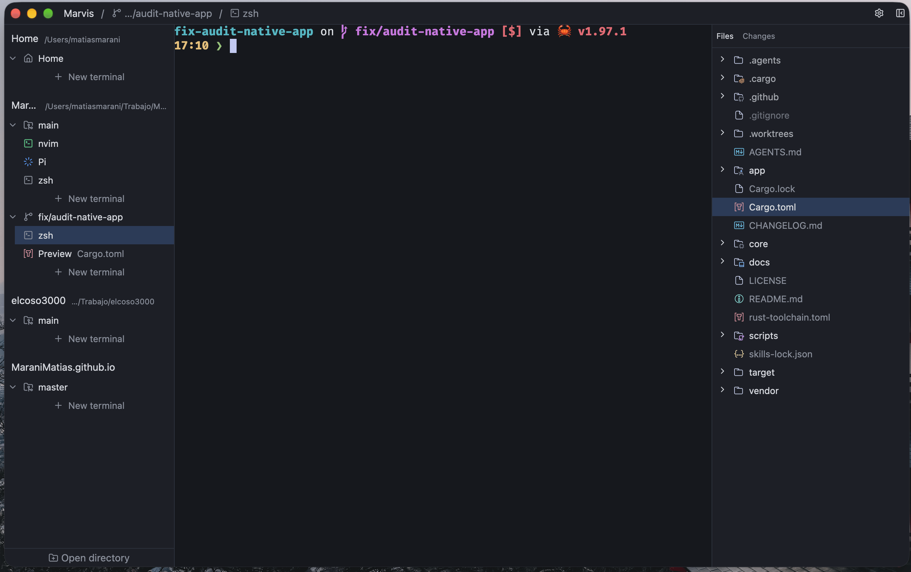

# Muster

Muster brings your repositories, worktrees, terminals, and code reviews together in one desktop window. Work with coding agents in separate worktrees, try their changes, and leave feedback on the lines that need attention.

You can send review notes to an existing OpenCode session, start a new Pi session with them, or export them as Markdown. You can also use Muster without an agent. Muster does not run AI models itself.



## Install

The current release is **v1.0.0**:

- [macOS, Apple Silicon](https://github.com/MaraniMatias/Muster/releases/download/v1.0.0/Muster_1.0.0_arm64.zip)
- [macOS, Intel](https://github.com/MaraniMatias/Muster/releases/download/v1.0.0/Muster_1.0.0_x86_64.zip)
- [Ubuntu, x86_64](https://github.com/MaraniMatias/Muster/releases/download/v1.0.0/muster_1.0.0_amd64.deb)
- [Ubuntu, arm64](https://github.com/MaraniMatias/Muster/releases/download/v1.0.0/muster_1.0.0_arm64.deb)

This is a stable release. Earlier candidates are on the [Releases page](https://github.com/MaraniMatias/Muster/releases).

### macOS

Muster requires macOS 15 or later. Download the archive for your Mac, unzip it, and move `Muster.app` to Applications. The app is ad-hoc signed and not notarized by Apple. If macOS blocks it, see [the Gatekeeper instructions](#why-does-macos-say-the-app-is-damaged-or-cant-be-opened).

### Ubuntu

Muster provides packages for Ubuntu 24.04 on x86_64 and arm64. Download the package for your computer, open a terminal in the download folder, and install it with:

```sh
sudo apt install ./muster_<version>_<architecture>.deb
```

Replace the filename with the one you downloaded. Packages for other Linux distributions and an AppImage are not currently provided.

## Get started

1. Open Muster and add a Git repository from the sidebar. You can also add a regular folder.
2. Select the repository or one of its worktrees, or create a worktree in Muster.
3. Open a terminal and start your usual tools or coding agent. Open another terminal if you want to run the project alongside it.
4. Select **Changes** to inspect the diff. Add notes to individual lines or ranges as you review.
5. Send your notes to OpenCode or Pi, or export them as Markdown.

A worktree is a separate directory connected to a Git repository. It lets you work on another branch without changing the files in your main checkout.

## What you can do

### Organize your work

The sidebar groups terminals under their repository or worktree. Muster detects worktrees created outside the app too. Create new ones, drag workdirs to reorder them, and move terminal rows between worktrees. You can also search for a worktree from the title bar.

Open multiple terminals in each worktree, search their output, and use the CLI tools you already have installed. With the modifier held, click a supported link in terminal output to open a web page or a file in the current checkout: Command-click on macOS, Control-click on Linux.

### Browse files and review changes

Use **Files** to browse a checkout, preview files, and make quick edits. Markdown and SVG files open as a rendered view, with a toggle for their source. Use **Changes** to inspect Git diffs and leave notes on added or removed lines, including ranges. Notes whose referenced code has changed are marked outdated.

The sidebar shows files with unsaved edits and files with review notes, so you can return to unfinished work. You can place the Files and Changes panel beside the main area or below the sidebar using the button in its header.

### Work with agents

- **OpenCode:** Install and run [OpenCode](https://opencode.ai). Muster can show session activity and send review notes to an existing session. If the session is busy, you can send now, queue the review, or cancel.
- **Pi:** Install [Pi](https://github.com/earendil-works/pi) v1.1.0. Muster can show its activity and send notes by opening a new interactive Pi terminal for each review.
- **Other CLI agents:** Run them in Muster's terminals and export your review notes as Markdown to share with them.

Muster is a workspace and review companion, not a full IDE or a GitHub or GitLab review client.

### Make the workspace yours

Open **Settings** to adjust terminal and editor sizes, terminal behavior, and review export options. The app uses a dark appearance. Changes to terminal and editor sizes require a restart.

## Your work and local data

Muster keeps workspace settings, delivered OpenCode review rounds, and preferences locally under `~/.muster`. Review exports are saved to the location you choose. Muster has no telemetry.

Review notes are held in the window and are not restored after you close the app. Export notes you want to keep. Queued and delivered OpenCode review rounds are stored so they can be sent or shown and settled later. Terminal processes and sessions do not survive an app restart; Muster opens a fresh shell instead. Repository files remain on disk.

Muster does not import workspace or review data from the older Legacy app. If a workspace or review state file is malformed or unsupported, Muster refuses to overwrite it. Back up the named file before removing it; deleting it starts that store empty.

## FAQ

### What is the difference between Archive and Delete?

**Archive** removes a worktree from the sidebar while keeping its files. You can restore it from the repository row. **Delete** removes the worktree directory from disk, along with its notes, review rounds, and associated UI state. Export anything you need first.

### What happens if a folder is missing or moved?

A missing folder stays registered. Its notes remain available if the path returns. Muster does not automatically reconnect a moved folder: opening it at the new path creates a separate registration.

Closing a missing checkout removes its registration and associated notes, rounds, and UI state, but does not delete files on disk. Removing a repository from the sidebar does the same for its checkouts.

### Can the terminal display images?

Yes. Muster supports Kitty graphics used by terminal applications, including OpenCode and Pi. Images are held in memory and may need to be redrawn when the terminal is resized. Sixel, iTerm2 images, animation, and tmux passthrough are not supported. Restart an existing Pi session after upgrading to use the image protocol.

### Why does macOS say the app is damaged or can't be opened?

The download is not notarized by Apple, so Gatekeeper may block it. Only bypass this protection if you trust the source and build. After moving the app to Applications, you can remove its quarantine attribute with:

```sh
xattr -dr com.apple.quarantine /Applications/Muster.app
```

If it still does not start, check the [startup log](#muster-wont-start).

### Muster won't start

Quit any running instance, then start Muster from a terminal to see its log:

```sh
# Linux
MUSTER_LOG=debug Muster
# macOS, when installed in Applications
MUSTER_LOG=debug /Applications/Muster.app/Contents/MacOS/Muster
```

If the error names a workspace or review state file, back it up before removing it. Deleting it starts that store empty; it does not remove your repository files.

## Development

See [AGENTS.md](AGENTS.md) for development and verification notes and the [release safety checklist](docs/release-safety.md) for builds and releases.

## License

[MIT](LICENSE)
