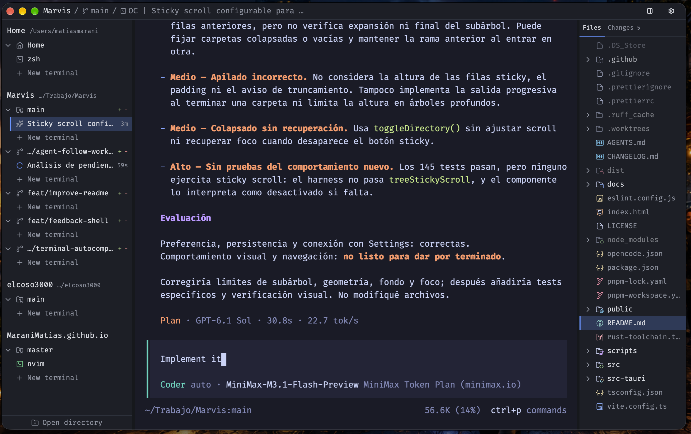

# Muster

Muster is a desktop workspace for people working with coding agents in Git worktrees. It keeps each repository and worktree’s files, diffs, and terminals together. Leave notes on specific diff lines, then send them to OpenCode, start a fresh Pi review session, or export them as Markdown. Muster does not run models; other CLI agents can be started in its terminals.

> **Native app:** releases target macOS (Apple Silicon) and Ubuntu 24.04
> (x86_64). The former Tauri app is retained under [`legacy/`](legacy) as
> reference material; it is not the released application.

- **Native release targets:** macOS (Apple Silicon) · Ubuntu 24.04 (x86_64)
- **License:** MIT



## Why

When several agents work in parallel, each worktree ends up with its own terminals and changes to review. Muster groups them by checkout in one window, so you can try the code, review the diff, and send feedback without switching between directories and copying comments from a browser. A checkout is the repository root or one of its worktrees.

## What you can do

- Browse and edit files, and inspect Git changes and diffs.
- Open multiple terminals in each repository or worktree; worktrees created outside Muster are detected too.
- Leave notes on diff lines or ranges and track them as draft, sent, or resolved. A note is marked outdated when the code it refers to changes.
- Send review rounds to an existing OpenCode session, start a new Pi terminal with selected notes as its first prompt, or export notes as Markdown for any CLI agent.

## What it is not

- Not an IDE. The editor is for quick changes, not a replacement for your main editor.
- Not an LLM harness. Muster does not call models or manage how agents run.
- Not a GitHub or GitLab client. Review notes go to OpenCode, a fresh Pi terminal, or a Markdown export.
- Not just a terminal. It also groups worktrees, shows diffs, and keeps review notes.

You can use any CLI agent, or work without one. OpenCode has native session and in-session delivery integration; Pi has native session observation and receives each review in a newly opened interactive terminal.

## Install

Choose a native candidate from [Releases](https://github.com/MaraniMatias/Muster/releases).
The `/latest` link may still select the frozen Legacy release. Existing candidates
may contain only a macOS archive; the new workflow adds Linux packages to future releases.

- **macOS 15+ (Apple Silicon):** Unzip `Muster_<version>_arm64.zip` and move `Muster.app` to Applications. The bundle is ad-hoc signed, not notarized; assess the source and build before bypassing Gatekeeper quarantine.
- **Ubuntu 24.04 x86_64:** When the release includes a `.deb`, install it with `sudo apt install ./muster_<version>_amd64.deb`. RC versions use Debian's `~` notation, e.g. `1.0.0~rc.3`. Linux ARM64 and AppImage are not provided by the native release path.
- **Other Linux:** No native package is currently provided.

For native OpenCode integration, install and run [OpenCode](https://opencode.ai). For Pi review delivery, install [Pi](https://github.com/earendil-works/pi) v1.1.0; each send starts a new interactive terminal. Other CLI agents work in Muster’s terminals, and notes can be exported as Markdown.

## Quick start

1. Open a Git repository.
2. Select a checkout or create a worktree.
3. Open a terminal in that checkout and start your agent.
4. Try the code in another terminal, then open **Changes** and add notes to the relevant diff lines.
5. Send notes to OpenCode or Pi, or export them as Markdown, then get back to what you were working on.

## FAQ

### Muster won’t start

The native app logs to stderr, not Legacy's log file. Quit any running instance,
then start the binary from a terminal to see the error:

```sh
# Linux
MUSTER_LOG=debug Muster
# macOS, when installed in Applications
MUSTER_LOG=debug /Applications/Muster.app/Contents/MacOS/Muster
```

Native workspace and review state are JSON files under `~/.muster`; preferences are in `~/.muster/settings.json`. A malformed or unsupported workspace/review file is refused rather than migrated or overwritten. Back up the named file before removing it; deleting it starts that store empty. Repository files are not affected.

### Why does macOS say the app is damaged or can’t be opened?

Gatekeeper marks a downloaded app with a quarantine attribute, so the launch is blocked before Muster can start. Clear it from the app you moved to Applications:

```sh
xattr -dr com.apple.quarantine /Applications/Muster.app
```

If Muster still does not start, read the [startup log](#muster-wont-start).

### Do terminals survive a restart?

No. Muster restores your workspace and UI state, but stops terminal processes when it closes and clears their sessions on startup.

### What happens when a folder is missing?

Missing folders stay registered; their notes remain available if the path returns. A moved folder is not reattached automatically: opening the new path creates a separate registration, and the two histories do not merge.

### What does closing a missing checkout do?

It deletes that checkout’s registration and attached notes, rounds, and UI state. No file on disk is touched, and opening the folder again brings the checkout back. Removing a repository from the panel does the same for every checkout under it.

### What is the difference between Archive and Delete?

**Archive** takes a worktree off the panel and keeps every file, so the repository row can restore it. **Delete** removes the worktree’s directory from disk.

> **Delete is the only action here that removes files.** It takes the worktree’s notes, rounds, and UI state with it, so export what you need first.

## Privacy and local data

Workspace data, review rounds and preferences are stored locally under `~/.muster`; review exports use the selected export location. Muster has no telemetry. Native workspace and review state are not migrated from Legacy SQLite. Back up files before manually resetting them.

## Maintainers

[Release safety checklist](docs/release-safety.md)

## Layout

| Path | What it is |
| --- | --- |
| [`core/`](core) | `muster-core`: the PTY backend and the workspace shapes its callers exchange. No window, no toolkit, nothing to keep in sync with a UI. |
| [`native/`](native) | `muster`: the app. GPUI Kit window, VT grid, keyboard and lifecycle. |
| [`legacy/`](legacy) | The Tauri 2 + Vue 3 app, frozen at `v0.22.0`. Not built, not tested, not released from here. |
| [`docs/native-rust-migration/`](docs/native-rust-migration) | Why the port, and what the terminal milestone has to satisfy. |

`core/` is a real dependency, not a shared folder: `native/` and the parked Tauri
tree both compile the same PTY implementation, so process lifetime, bounded
writes and group-safe shutdown exist once.

## Build and run

Requires the Rust toolchain in [`rust-toolchain.toml`](rust-toolchain.toml) and,
for the security audit only, Node 22. Linux builds also require Vulkan, X11,
xcb, XKB, freetype and fontconfig development packages; Ubuntu package names
and the native Linux release process are documented in [release safety](docs/release-safety.md).

```sh
rustup run 1.97.1 cargo run --locked -p muster
rustup run 1.97.1 cargo run --locked -p muster -- /some/dir
rustup run 1.97.1 cargo build --locked --release -p muster

rustup run 1.97.1 cargo test --locked --workspace
rustup run 1.97.1 cargo clippy --locked --workspace --all-targets -- -D warnings
rustup run 1.97.1 cargo fmt --all --check
node scripts/audit-rust.mjs                # RustSec over the locked graph

scripts/perf-native.sh                      # the terminal hot-path cost table
```

`MUSTER_LOG=debug cargo run -p muster` prints what the terminal refuses
and what it could not do. Without a sink installed every one of those records
would be discarded, so the app installs one before anything that can log.

## State

The native app is a **terminal with the workspace panel around it**:
repositories and worktrees in a sidebar, live terminals grouped under them,
line counts counted against Git, a searchable worktree picker in the title bar,
worktree creation and archive-or-delete dialogs, drag to reorder or move a
terminal between worktrees, and a window state file.

The native app includes review notes and agent delivery/export, editable
preferences, file activation and terminal search. See the [native migration
notes](docs/native-rust-migration/README.md) for implementation details.

[`Terminal implementation status`](docs/native-rust-migration/ghostty-reference.md)
records the implemented behavior, remaining parity work, and measured costs (§12).
The app uses one dark appearance. Native state lives in
`~/.muster/native-workspace.json`, independently of Legacy SQLite; a single-instance
lock protects it and shutdown flushes the latest accepted navigation snapshot.
Git discovery/counting stays active at a slower cadence in hidden windows.

`legacy/` keeps the former Tauri release (v0.22.0) for reference. It is not built
or packaged by the native release workflow.

## License

[MIT](LICENSE)