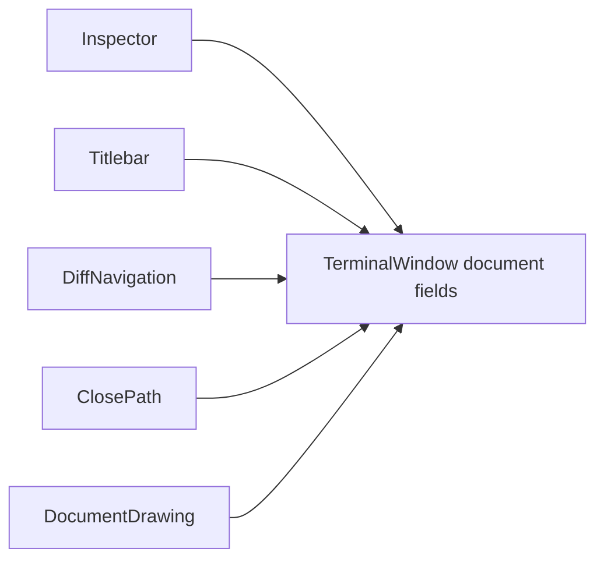
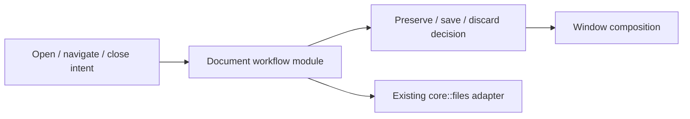
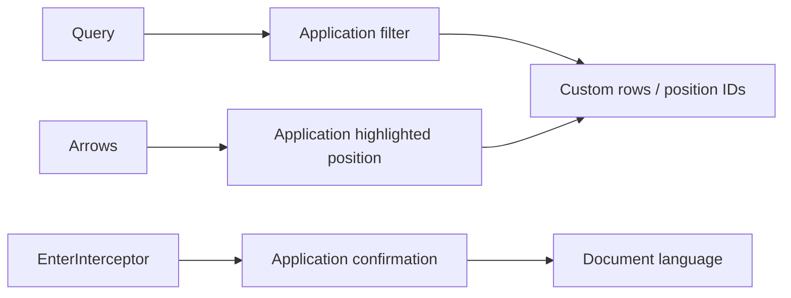
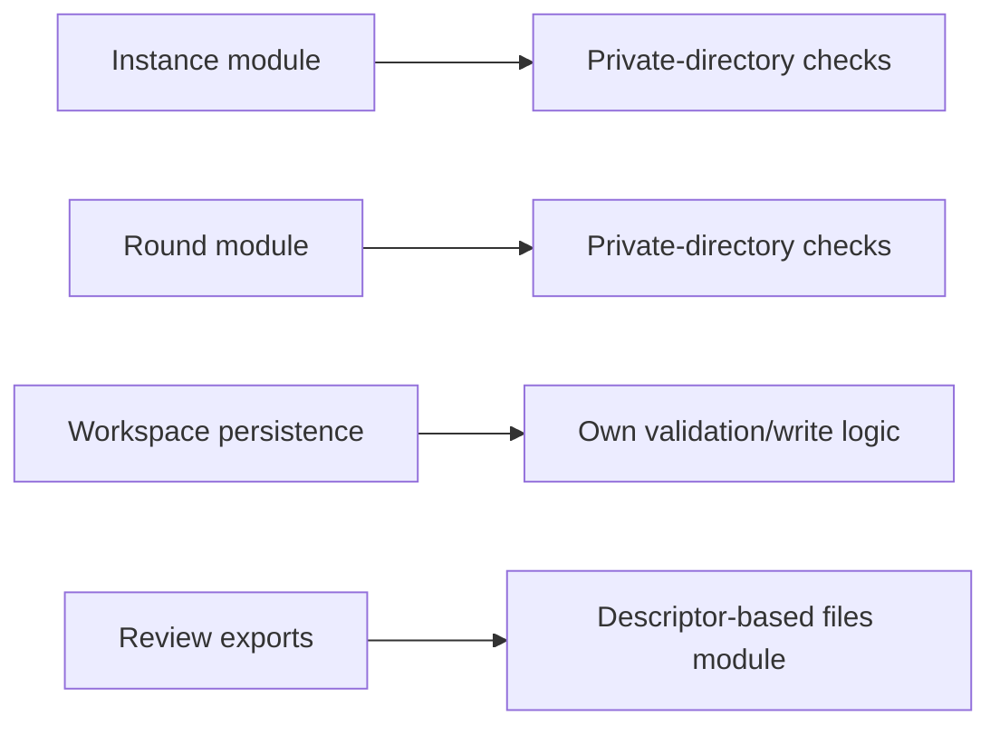
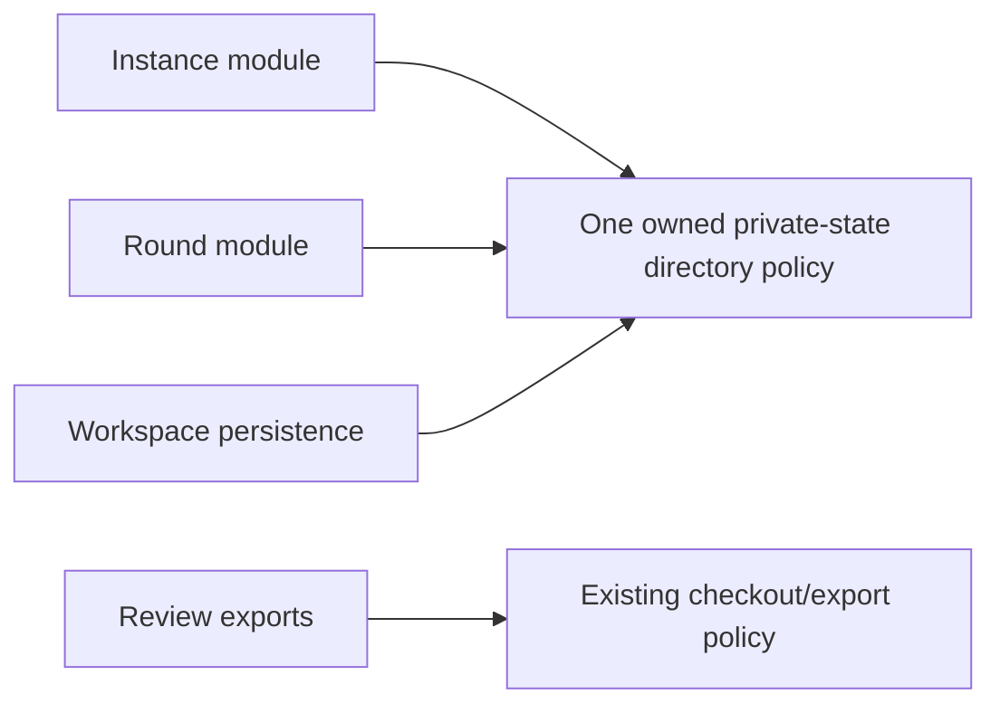

# Native Rust Audit — 2026-10-17

> Scope: the native Muster application, its Rust core, and its verification/release tooling. `legacy/` is not an audit target.
>
> This is an assessment, not an implementation plan already approved for execution. No application code was changed during this audit.

## 1. Baseline and executive assessment

| Item | Audited baseline |
| --- | --- |
| Date | 2026-10-17, local timezone CEST |
| Commit | `07341c4` — `chore: update and improve diff note` |
| Branch | `docs/native-rust-gpui` |
| Application/core versions | `0.1.0` |
| Compiler | `rustc 1.97.1 (8bab26f4f 2026-07-14)` |
| Cargo | `cargo 1.97.1 (c980f4866 2026-06-30)` |
| Environment | macOS; native UI tests use GPUI test support |
| Existing untracked material | `.agents/` and `skills-lock.json`; left untouched |

### Overall conclusion

The native application has a materially stronger foundation than a superficial reading of its large UI files suggests. Its important protections are real: descriptor-based file access, bounded PTY queues, deliberate process-group shutdown, revision-based rejection of stale results, a coalescing workspace writer, pinned parser backports, and substantial tests of real UI composition.

**The recommendation is targeted correction, not a rewrite or a crate-per-screen reorganization.** The highest-value work is protecting unsaved documents, aligning the save implementation with its concurrency promise, making the terminal accessible, and correcting several concrete input/UI defects. Further architectural work should deepen ownership of those workflows rather than distribute the same fields among more files.

The checks executed here are green, but that is not a release certification. The suite misses several meaningful cases, and neither headless tests nor parser/snapshot measurements establish real-window accessibility, GPU performance, native IME behavior, or Linux desktop acceptance.

### Priority summary

| Priority | Meaning | Findings |
| --- | --- | --- |
| P0 | Confirmed critical issue requiring immediate containment | None established by this audit |
| P1 | Risk to user work or exclusion from a primary workflow | A01, A02, A06 |
| P2 | Concrete correctness, lifetime, durability, or verification defect | A03, A04, A05, A07, A08, A09, A10, A11, A12 |
| P3 | Smaller verification or maintenance gap | A13 |

Priority reflects consequence, not implementation size. For example, the function-key correction is tiny and should be made early even though protecting drafts has greater product impact.

## 2. Method, standards, and limits

### Standards applied

1. **Rust Best Practices:** ownership and cloning, error handling, concurrency and pointer ownership, linting, measurement before optimization, and behavior-focused tests. Relevant references: chapters 1–5 and 9 under `.agents/skills/rust-best-practices/references/`.
2. **Improve Codebase Architecture:** start with actual change hotspots, examine module depth and locality, apply the deletion test, distinguish a real seam from a hypothetical adapter, and propose only opportunities with concrete leverage.
3. **GPUI Kit Coding Guides:** retained state, stable identity, component behavior ownership, focus/actions, background work, stale-result guards, rendering cost, and testing at the appropriate layer.
4. **GPUI Kit Design Guides:** task clarity, truthful interaction states, keyboard access, accessible names, overlays, consistent selection, geometry, and restraint in presentation.
5. **Project rules in `AGENTS.md`:** the two-crate split, file access through `core::files`, the app-owned theme, separate terminal/icon palettes, deliberate worktree mutation behavior, and the pre-1.0 storage policy.

The architecture skill normally produces an HTML exploration report. This audit instead uses the requested **in-repository Markdown** format, including conceptual before/after diagrams. No HTML report, browser opening, glossary creation, ADR creation, or refactor was performed. The skill's referenced `codebase-design`, `grilling`, and `domain-modeling` skills were not available among the inspected project skills; no claim is made to have loaded them. No `GLOSSARY.md` or `docs/adr/` was found. The product's existing terms and `AGENTS.md` therefore supply the domain constraints.

### Investigation strategy

Recent changes repeatedly touched `app`, `document`, `inspector`, `diff`, `review`, terminal handling, and their tests. Those workflows received particular attention. Two bounded read-only investigations covered core/security/tooling and terminal internals respectively. Implementation-critical findings were checked against the current source before inclusion; unsupported or incorrect leads were rejected rather than copied into the findings.

This is a path-based audit, not a claim that every line in the repository was exhaustively inspected. Coverage includes:

| Area | Review depth |
| --- | --- |
| `core/src/files.rs` | Checkout policy, reads, writes, exports, durability, relevant tests |
| `core/src/navigation/` | Discovery, Git execution, persistence, instance locking, worktree mutations and tests |
| `core/src/opencode*` | Discovery/transport, round state, storage bounds, locking, delivery semantics and tests |
| `core/src/pty/` | Reader termination, shutdown ownership, process groups, bounded writes and tests |
| `core/src/review.rs` | Note validation, anchors, Markdown generation and tests |
| `native/src/app.rs` | State ownership, async completion, navigation, close/quit, rendering and tests |
| `native/src/document*` | Editing/saving/formatting, language picker, media policy, relevant tests |
| `native/src/inspector.rs`, `diff.rs`, `review.rs` | Request lifetimes, caches, tree preparation, range composition, export/send paths |
| `native/src/terminal/`, `session_owner.rs`, `terminal_parser.rs` | Input encoders, IME, snapshot/paint, queues, task ownership, close lifecycle, tests |
| Sidebar/titlebar/dialogs/toasts/theme | Selected interaction paths, semantic controls, ownership and relevant test coverage |
| Cargo, CI and `scripts/` | Toolchain/lock discipline, audit gate, backport pins, local release flow and packaging constraints |

Generated icon data and vendored parser internals were not subjected to a fresh line-by-line third-party review. The existing hash-pin checks and parser regressions were exercised by the relevant suites. Existing tests may use frozen assets or token references from `legacy/`; running those tests does not turn Legacy into an audit target.

### Evidence levels

- **Executed:** a check or probe ran during this audit.
- **Static/high confidence:** the current production path directly establishes the condition, but the full user interaction or failure interleaving was not reproduced.
- **Investigation:** plausible, but platform behavior, reachability, or impact still needs confirmation.
- **Opportunity:** maintainability or efficiency improvement, not a demonstrated user-facing failure.

No vulnerability-database query, destructive worktree operation on a real project, browser launch, production workspace modification, or manual application session was performed. The live OSV audit was **not** run; passing its unit tests does not establish that the locked graph has no current advisories.

## 3. Verification actually executed

### Automated checks

The pinned toolchain directory was put first on `PATH`, and both versions were verified before Rust checks.

| Check | Result |
| --- | --- |
| `cargo fmt --all --check` | Passed |
| `cargo clippy --locked --workspace --all-targets -- -D warnings` | Passed; transitive future-incompatibility notice described below |
| `cargo test --locked --workspace` | Native: **364 passed, 3 ignored**; core: **159 passed**; instance-lock integration: **4 passed**; no failures |
| `node --test scripts/audit-rust.test.mjs scripts/release.test.mjs` | **23 passed**, no failures |
| `cargo test --locked -p muster perf:: --release -- --ignored --nocapture --test-threads=1` | **3 passed**, 364 native tests filtered out; measurements below |
| Temporary Rust probe importing production `terminal/keys.rs` and `modes.rs` | Six F-key mismatches; six conventional Ctrl punctuation/space combinations returned `None` |
| `cargo report future-incompatibilities --id 1` | Confirmed `block 0.1.6` warning about an uninhabited static |

The default Rust suite therefore executed **527 passing tests**, excluding empty test/doc-test targets. The three ignored performance cases were then run separately in release mode. These are current run counts, not the historical counts in the migration action plan.

The temporary key probe compiled the actual production source modules rather than a copied implementation, and its files were removed with the temporary directory. It did not send input to a user's shell.

### Release-mode measurements

These are one-machine operation timings, **not frame times, GPU measurements, service-level budgets, or universal thresholds**. The existing measurement module explicitly documents that it does not paint.

| Operation | 80×24 | 300×100 |
| --- | ---: | ---: |
| `session.title()` | 0.027 µs | 0.027 µs |
| `session.selection_text()` | 5.796 µs | 34.985 µs |
| `session.selection_range()` | 0.012 µs | 0.012 µs |
| `session.snapshot()` | 20.452 µs | 250.441 µs |
| `session.painting_snapshot()` | 15.869 µs | 215.269 µs |

Other measured results:

- Warm-width tree preparation: **10.262 µs for the 74-row fixture**, **119.275 µs for the 908-row fixture**. These are the fixtures' actual flattened row counts, not the number of rows painted onscreen.
- Idle 300×100 snapshot: **217.664 µs**.
- One idle session close: **12.227 ms**. This is not the worst-case shutdown deadline.

### Not verified here

- A complete release **application binary build**, bundle assembly, signing verification, notarization, or distribution installation. Compiling release-mode test binaries is not equivalent to these checks.
- Live OSV/RustSec advisory status.
- Linux build/test execution on this host; the CI configuration was inspected.
- VoiceOver, a live accessibility-tree inspection, native keyboard layouts/dead keys, or candidate-window placement in a real macOS window.
- Real GPU rendering cost, display-scale transitions, sustained RSS, long-session leaks, or power-loss durability.
- Windows behavior; the application is POSIX-shaped and should not acquire an unsupported portability claim from this report.

## 4. Findings

### A01 — Navigation and close paths can silently discard an unsaved document

**Priority:** P1 · **Evidence:** static/high confidence · **Category:** user-work preservation

**Locations:** `native/src/document.rs:1229–1242` (`clear_document`), `native/src/inspector.rs:966–1007` (`request_document`), `native/src/titlebar.rs:538–549` (`select_crumb_target`), `native/src/diff.rs:253–305`, `native/src/app.rs:1291–1332` (window close).

`clear_document` removes `document_view`, clears the loaded preview and invalidates the request without consulting whether the editor is dirty. Ordinary navigation calls it: opening another file, selecting another checkout/change set, and choosing a titlebar target. Window close checks running terminals and pending shell creation, not an unsaved editor.

**Trigger:** open a file, type a change, then click another file or checkout. The only retained draft is dropped. Closing an otherwise idle window has the same preservation gap. This is distinct from explicitly pressing the document's Cancel/Escape action, which is an intentional discard.

The document has a proper save/cancel footer and a comparison-based dirty flag. Those are useful, but they do not protect transitions that bypass the footer. Saving and then immediately navigating also deserves a test: a failed save must not disappear into a detached completion after the editor was discarded.

**Smallest complete improvement:** route destructive document transitions through one owner decision: save, explicitly discard, or cancel the transition. Preserve the pending destination and apply it only after the decision succeeds. Do not add disk autosave or session restoration merely to solve this.

**Regression checks:** real UI tests for dirty file → another file, checkout/terminal selection, pane close and window close; cancelling preserves the draft and selection; save failure preserves the draft; successful save applies the original navigation intent exactly once.

**Skill basis:** truthful action outcomes, explicit state ownership, and tests of the workflow rather than only the save helper.

### A02 — The save operation is atomic replacement, not an atomic compare-and-replace

**Priority:** P1 · **Evidence:** deterministic late-revalidation interleaving test; arbitrary external-writer race remains · **Category:** data integrity

**Locations:** `core/src/files.rs:481–545`, `core/src/files.rs:848–898`; native caller at `native/src/document.rs:848–921`.

`write_preview` reads through a validated descriptor and rejects a mismatch with `expected`. It then creates, writes and syncs another file, and finally renames it over the destination **name**. Another writer can change or replace the destination between comparison and rename. Its new bytes are then replaced even though the documented promise says another actor's edit is not overwritten.

```text
Muster: open/read destination -> expected matches -> prepare temporary file ------> rename
Other:                                             write or replace destination
Result: the other edit can be replaced without a conflict being reported.
```

The existing checks are valuable: they reject an edit already present at comparison time, reject symlinks during traversal, and avoid partial content. Those properties are not the stronger cross-process compare-and-swap property.

**Important correction constraint:** an app mutex, advisory lock, extra `stat`, or second read alone does not guarantee protection against an arbitrary non-cooperating external writer. A test hook is a way to demonstrate the race, not the fix.

**Implementation evidence (updated):** `write_preview` serializes saves within this process and reopens the target immediately before `renameat`, checking both device/inode identity and content. The regression now injects an inode replacement through the real `write_preview` publication path after temporary-file preparation and confirms refusal. A separate injected directory-sync failure confirms that the API reports `PublishedButNotDurable` while the new bytes are visible. Native transitions remain pending through a failed save; after publication with uncertain durability, the pane advances its visible baseline and exposes a retry rather than navigating. A pending intent can also be explicitly cancelled with **Stay here**.

This is not a cross-process or arbitrary-external-writer compare-and-swap. POSIX `renameat` on macOS/Linux replaces a name unconditionally; a writer can change that name after final revalidation but before rename. A second stat/read or advisory lock cannot close that gap for a non-cooperating writer, and this implementation makes no unconditional protection claim. A post-rename directory-sync failure also cannot restore the old name; it is an explicit uncertain-durability result, not a failure that leaves the original untouched.

### A03 — F6 through F11 emit incorrect terminal sequences

**Priority:** P2 · **Evidence:** executed against production encoder · **Category:** terminal compatibility

**Locations:** `native/src/terminal/keys.rs:269–274`; existing test at `keys.rs:698–749`.

The F5–F12 table is `[15, 16, 17, 18, 19, 20, 21, 24]`. The corresponding xterm sequence numbers are `[15, 17, 18, 19, 20, 21, 23, 24]`.

| Key | Current suffix after `CSI` | Expected suffix |
| --- | --- | --- |
| F5 | `15~` | `15~` |
| F6 | `16~` | `17~` |
| F7 | `17~` | `18~` |
| F8 | `18~` | `19~` |
| F9 | `19~` | `20~` |
| F10 | `20~` | `21~` |
| F11 | `21~` | `23~` |
| F12 | `24~` | `24~` |

A TUI can ignore a key or execute the action assigned to a different key. In particular, F11 emits the conventional F10 sequence; that does **not** mean the current encoder emits identical bytes for its own F10 and F11.

The current test covers F1–F4, F5, F12 and invalid numbers, but skips the six wrong entries. The explanatory comment also incorrectly treats 23 as unused.

**Smallest improvement:** correct the table and comment; extend the existing table-driven check to every F1–F12 key, including negotiated modifiers. No abstraction or dependency is needed.

### A04 — Conventional Ctrl+space/punctuation control codes are dropped

**Priority:** P2 · **Evidence:** executed against production encoder · **Category:** terminal input

**Locations:** `native/src/terminal/keys.rs:211–232`, `keys.rs:306–317`; delivery decision at `native/src/terminal/session.rs:1752–1766`.

`control_byte` accepts letters only. The temporary probe confirmed `None` for Ctrl+Space, Ctrl+`[`, Ctrl+`\`, Ctrl+`]`, Ctrl+`^` and Ctrl+`_` in the default mode. These have established terminal encodings: NUL, ESC, FS, GS, RS and US respectively. A Ctrl+`[` escape binding or Ctrl+Space editor command therefore never reaches the child through this path.

The refusal is deliberate in the current comment, but deliberate omission does not make the terminal-compatible mapping ambiguous. This should be treated as a supported-input decision, not silently presented as complete keyboard support.

**Smallest improvement:** add the conventional mappings to the existing encoder, keeping negotiated protocol behavior explicit. Test bytes rather than merely testing that input produced some output. Verify the platform event mapping separately, because a pure encoder test cannot prove that every physical layout reports the same character/modifier pair.

### A05 — Filtering the syntax picker breaks its visible keyboard highlight

**Priority:** P2 · **Evidence:** static/high confidence · **Category:** GPUI interaction state

**Locations:** `native/src/document.rs:600–641`, `document.rs:1102–1127`; tests at `native/src/inspector_tests.rs:1865–1954`.

The menu enumerates filtered matches as `(position, index)`. `document_grammar_highlight` is a **position in the filtered list**, but rendering uses `*index == highlighted`, comparing it to the original grammar-list index. Confirmation correctly indexes the filtered list.

For a query whose matches originally occupy indices 20 and 21, highlight position 0 matches neither rendered row. Enter still confirms the first filtered row, even though it has no corresponding keyboard-highlight wash. Arrow movement has the same discrepancy.

**Smallest improvement:** compare the filtered `position` with `highlighted`. Keep the persisted language choice distinct from the current keyboard target; they are different states. The row IDs are also position-derived, which is worth revisiting when improving this picker, but that is not necessary to demonstrate this bug.

**Regression:** filter out the initial entries, move Down/Up, verify the actual highlighted row styling/state, then confirm and check the selected language. The existing keyboard test navigates the unfiltered list, where the two coordinate systems coincide.

### A06 — The custom terminal does not expose its content through an accessibility surface

**Priority:** P1 · **Evidence:** static/high confidence; no VoiceOver session executed · **Category:** accessibility

**Locations:** `native/src/terminal/view.rs:1855–1952`, `view.rs:1957–2087`.

The terminal has retained focus, a stable element ID, keyboard handlers and a native input handler. However, its screen is drawn through a canvas and painting calls. The inspected terminal code adds no semantic role/name or accessibility representation of visible output, caret or terminal selection. `text_for_range` exposes only the IME composition buffer, not terminal content; `character_index_for_point` returns `None`.

An IME input contract is not itself a screen-reader representation. The painting and text-input work already implemented should be preserved rather than conflated with the missing accessibility layer.

This is a significant omission because the terminal is the product's primary work surface. In contrast, the grammar picker and toasts already demonstrate semantic roles elsewhere in the same application.

**Implementation evidence:** GPUI `gpui-pre 0.3.9` is not limited to labels: its AccessKit integration exposes `Element::a11y_synthetic_children`, `A11ySubtreeBuilder`, `Role::TextRun`, UTF-8 character lengths, and `Node::set_text_selection`; the locked platform crates contain concrete macOS, Windows and Linux X11/Wayland adapters. The terminal now contributes a stable `MultilineTextInput` node with a `TextRun` child built from the visible VT grid, maps its cursor and selected grid cells into text offsets, and bounds the exposed text to 65,536 characters. It does not claim shell scrollback beyond the currently displayed grid. The same node advertises the keyboard route from chrome: application modifier + Shift+Escape. The shortcut transfers focus only when a terminal is open, does not steal the key when the terminal already owns focus, and does not change Tab/Shift+Tab routing.

Tests assert the terminal's semantic role, name and focused state through GPUI test-support, exercise the focus transfer through the production window handler, and cover the visible-text/caret/selection projection and cap with pure tests. The GPUI test-support API does not expose synthetic child text or AccessKit `TextSelection`, so those properties are not claimed as tree-tested. The production tree construction uses GPUI's actual AccessKit APIs rather than treating a label as readable output.

**Remaining acceptance:** no VoiceOver session or packaged-app accessibility-tree inspection was run. Verify that VoiceOver can read the changing visible output and announce caret/selection coherently, and exercise a running TUI while transferring focus from chrome. This is manual platform acceptance, not a GPUI API blocker. The test bridge does not emulate the OS screen reader.

### A07 — Formatting has no process deadline and only checks output size after allocation

**Priority:** P2 · **Evidence:** static/high confidence · **Category:** resource lifetime/recovery

**Locations:** `native/src/document.rs:378–415`, `document.rs:953–1063`, footer around `document.rs:1698–1758`.

The formatter subprocess uses `Command::output()`. It has no timeout/cancellation contract, and stdout size is checked only after `output()` has collected it. Stderr is also collected without an application-side bound.

Moving it to a background executor prevents synchronous UI blocking, but does not bound the subprocess, buffered output or occupied worker. A hung user-installed formatter leaves the document in `formatting = true`, which also blocks Save until the operation completes. Navigating away drops interest in the answer but does not establish subprocess cancellation.

The surrounding trust policy is good: executable resolution excludes the checkout, configuration and editorconfig are disabled, and `NODE_OPTIONS`/`NODE_PATH` are removed. This finding is **not** a claim that project configuration is being executed or that a malicious checkout controls the formatter binary.

**Smallest complete improvement:** bound execution time and both output streams while reading; terminate/reap the child on timeout and restore an actionable editor state. Reuse the established bounded-process principles from Git reads without forcing Git-specific code into a general framework.

**Tests:** fake formatter that waits indefinitely; oversized stdout/stderr; process failure; navigation during formatting; successful formatting still remains a draft and does not save automatically.

### A08 — Completed OpenCode rounds accumulate against a fixed 8 MiB store cap

**Priority:** P2 · **Evidence:** static/high confidence · **Category:** long-term operability/persistent state

**Locations:** `core/src/opencode/rounds.rs:62`, `rounds.rs:201–242`, `rounds.rs:329–341`, `rounds.rs:560–567`, `rounds.rs:722–740`.

Every round retains its notes and prompt. Acknowledgment changes status but does not release its stored payload. No inspected retention/removal path shrinks completed history. Eventually a proposed new state exceeds `STATE_CAP` and is refused.

**Precisely what fails:** capacity-consuming writes, especially new sends, eventually cannot be persisted. This is not an assertion that every operation becomes permanently impossible: the previous on-disk file remains below the cap, and some status changes may still fit. The problem is the absence of a supported capacity-recovery path, not corruption of the previous file.

**Improvement direction:** define explicit history retention/archive/removal for settled rounds, with a recoverable capacity message. Never silently discard pending/unknown delivery state. Do not naively prune acknowledged rounds either: round history also contributes to determining which unchanged notes were already sent. Retention must preserve the intended deduplication semantics or make the scope change explicit to the user.

**Tests:** near-cap state, an attempted send that would exceed it, unchanged disk state on refusal, safe recovery, preservation of unresolved rounds, and no unintended duplicate-send eligibility after history cleanup.

**Implementation evidence (corrected after independent review — see §13):** capacity is a policy rather than a wall, in two steps, and the claim is now a bounded key rather than the notes themselves. A write that would pass three quarters of the 8 MiB cap first gives up what no reader can ask for again: `RoundFile::compact` empties the prompt of every **settled** (`dispatched`/`acked`) round, because `flush_rounds` only offers `queued`, `reconcile_round` returns early for a settled round, and `resend_round` only leaves `unknown` — so a settled prompt is unreachable. Nothing unresolved is touched: `queued` is still offered, and `dispatching`/`unknown` are settled by a person reading the exact bytes. What deduplication is decided against is `ReviewRound::claim`, one `id:digest` key per claimed note (`review::review_note_key`: the note's id beside a 64-bit digest of the length-prefixed canonical snapshot). It is derived from the note rather than being the note, so `claimed_keys` answers the same way whether the round still carries its notes or has given them up: an unchanged note is still never offered again, the same review asked for again is still answered from the same round, and an edited note is still a new comment. An id with a control character in it is refused by `check_review_note`, which is what makes one key per line unambiguous.

The deliberate second step is `RoundStore::forget_settled_history`, wired to **Settings → Forget delivered reviews…** — reachable from any window state, because the store is one file for the whole workspace and the moment a person needs room is usually a moment with no diff open. A confirmation dialog names the scope (every checkout), what stays (the keys, so no new duplicate eligibility) and what is lost (those reviews can no longer be shown or exported); it never touches an unresolved round. A write that still does not fit is refused **before** the temporary file is opened, with a message that names the recovery, so the file on disk is byte-for-byte the one that was there.

Tests added: `a_store_near_its_cap_gives_up_what_nothing_can_read_again_instead_of_refusing_a_send` (planted store over the cap, a send that cannot fit is persisted, the queued round keeps its prompt and notes, delivered rounds lose only the prompt and still hold their notes, an edited note is still a new comment); `a_store_with_nothing_left_to_give_up_refuses_the_send_and_is_left_exactly_as_it_was` (every round unresolved, so nothing may be given up: the send is refused and the file is unchanged byte for byte, with nothing on the wire); `forgetting_delivered_reviews_keeps_them_from_being_sent_again`; `what_a_forgotten_review_keeps_does_not_grow_with_the_review_it_sent` (sixty-four forgotten reviews of notes at the byte limits encode to exactly the same size as sixty-four forgotten one-byte reviews, each key under 64 bytes, and the key that is left still refuses the unchanged note while still offering the edited one); `review::tests::a_key_says_the_same_thing_about_a_note_as_the_note_itself_does`; and the headless UI test `forgetting_delivered_reviews_asks_first_and_says_what_it_costs`, which now drives the route **with no diff open** as well as with one.

**Schema change:** `SCHEMA_VERSION` is now `3`, and a store written by an earlier build is refused by name with a message that says deleting it starts an empty review history. This follows the pre-1.0 rule in `AGENTS.md` rather than migrating, and it is the one consequence a person upgrading has to make deliberately: the delivered-review history of a `2` store is not read, so it has to be deleted.

**Remaining verification:** opening the dialog through the Settings dropdown was not driven in a test, and no real-window confirmation of the menu item's wording was taken. No test covers a store that is already over the cap on disk — such a file is still refused by `read`, which is unchanged behaviour. The key's digest is the same 64-bit FNV-1a the line anchors use: it is not a security primitive, so a store is judged on deduplication being conservative rather than on collision resistance.

### A09 — Document replacement omits the containing-directory durability sync

**Priority:** P2 · **Evidence:** parent-directory fsync implemented; power-loss behavior and injected fsync failure not reproduced · **Category:** save durability

**Locations:** `core/src/files.rs:866–898`. Compare review export at `files.rs:823`, navigation persistence at `core/src/navigation/persistence.rs:234`, and rounds at `core/src/opencode/rounds.rs:594`.

The save helper syncs the temporary file and renames it, then returns success without syncing the parent directory. The other inspected persistent writers include a directory sync. Atomic visibility and durable directory-entry replacement are separate guarantees; a successful save is not necessarily durable across an abrupt system failure without the latter, subject to platform/filesystem semantics.

**Implementation evidence:** `replace` calls `fsync` on the already-validated parent descriptor after rename. `WritePreviewError` distinguishes `BeforePublication` from `PublishedButNotDurable`; native document UI reports the latter explicitly and advances the loaded baseline to the visible bytes, preventing retry from using a stale expected value. Focused `core::files` tests pass, including save and conflict cases.

**Remaining verification:** no injected parent-fsync failure test or power-loss reproduction was added. A directory-sync error necessarily means replacement may already be visible; the UI keeps the document/draft and does not claim durable success. Filesystem and OS power-loss guarantees remain platform-dependent.

### A10 — Embedded code can close the exported review's Markdown fence

**Priority:** P2 · **Evidence:** static/high confidence · **Category:** export correctness

**Location:** `core/src/review.rs:392–397`; existing export test at `review.rs:569–666`.

`build_review_markdown` surrounds captured code with a fixed three-backtick fence. A reviewed Markdown document, generated string, or other source containing a closing fence can terminate that block early. The remaining source is rendered as document structure rather than quoted code. The same generator supplies the human export and text sent in a review prompt.

This is a structural-integrity problem. It is not, by itself, evidence of remote code execution or a guarantee that Markdown escaping can eliminate all prompt injection from untrusted source.

**Smallest improvement:** choose a fence longer than every backtick run in the embedded code, preserving the existing language/range notation and old-side signs. Test multiline code containing three and longer backtick runs.

The comment body already prefixes every `.lines()` entry with `> `, including internal blank lines. A separate allegation that internal blank lines necessarily escape the blockquote is not supported by the current code and is not included as a finding.

### A11 — IME preedit geometry assumes one cell per Unicode scalar

**Priority:** P2 · **Evidence:** static/high confidence; visual impact not reproduced in a real window · **Category:** international input/layout

**Location:** `native/src/terminal/view.rs:1385–1424`.

The composition span uses `composition.chars().count()` times one cell width. The rest of the terminal explicitly models wide characters. CJK composition and combining sequences therefore have no guarantee of matching the painted text's width. The span also has no local remaining-columns clamp; the terminal root shown at `view.rs:1855–1952` does not explicitly clip that composition to the grid.

**Trigger to verify:** compose Japanese or Chinese text near the right edge, and compose a combining sequence. Inspect the preedit underline/background, clipping and native candidate-window position.

**Smallest improvement:** use the terminal's established display-width semantics and constrain painting to the available grid bounds. Verify the resolved result; counting scalar values, UTF-16 units or bytes are not interchangeable solutions.

**Implementation evidence:** preedit width now uses the same `unicode-width` package/version family as the VT parser, treating wide characters as two cells and combining marks as zero, with a one-cell minimum for a zero-width-only preedit. Its span is clamped to remaining grid columns and the paint pass is masked to that span. Pure tests cover ASCII, CJK, combining marks, the last column, and a cursor beyond the right edge; existing UTF-16 replacement tests remain in place.

**Remaining acceptance:** no native IME or VoiceOver session was run. In particular, candidate-window placement and actual platform clipping still require a Japanese/CJK composition smoke test near the right edge; the unit tests make no claim about those OS behaviors.

### A12 — An OpenCode test mutates process-global environment during parallel tests

**Priority:** P2 · **Evidence:** static/high confidence · **Category:** test isolation/concurrency safety

**Location:** `core/src/opencode.rs:733–758`.

`the_registration_path_follows_the_state_directory_when_one_is_set` uses unsafe `set_var`/`remove_var` to modify `XDG_STATE_HOME`, reads it and restores it. Other discovery tests in the same process can read that environment concurrently. Restoration does not serialize the interval, and a mutex used only by this one test would not protect unrelated environment readers.

The successful workspace run is useful evidence of today's result, not proof that the test arrangement is race-free.

**Smallest improvement:** test registration-path construction with an explicit state-directory input, keeping environment lookup at the existing discovery entry point; alternatively isolate the environment-dependent check in a subprocess. Avoid creating a global configuration abstraction for one path-building concern.

**Verification:** run the focused suite repeatedly with multiple test threads. The test must no longer mutate the parent test process's environment.

### A13 — CI omits the existing release-script tests

**Priority:** P3 · **Evidence:** verified configuration and executed tests · **Category:** verification parity

**Locations:** `.github/workflows/ci.yml:30–31`, `scripts/release.sh:33–38`, `scripts/release.test.mjs`.

The local release check runs both Node test files. CI runs only `audit-rust.test.mjs`. Therefore release command validation and the explicit `strip = "none"` regression guard are not continuously checked by that Node step.

The macOS release build is still in CI, so a broken release profile may fail later. This is a missing focused guard and divergence between the two entry points, not absence of all release verification.

**Smallest improvement:** run both existing Node test files in CI. They already pass together: 23 tests in this audit. No new test infrastructure is necessary.

## 5. Architecture and maintainability opportunities

These are deliberately separate from defects. A large file, a clone, a public record, or a manual canvas is not automatically wrong. Each candidate below identifies a real seam and the reason a deeper module could offer leverage. No new Rust interface is prescribed before the workflow decisions are settled.

### O01 — Deepen document-transition ownership, not the entire window

**Recommendation strength:** Strong · **Related findings:** A01, A02, A07

**Files:** `native/src/app.rs:419–544`, `native/src/document.rs`, `native/src/inspector.rs`, `native/src/titlebar.rs`, `native/src/diff.rs`.

**Friction:** the document's target, loaded preview, editor, request generation, grammar popup, dirty/saving/formatting state and navigation invalidation are coordinated through fields on `TerminalWindow`. Splitting drawing into files has not created a document-transition seam: several modules can still discard the editor without its owner deciding.

**Before:**



**After, conceptually:**



**Depth and interface:** the module should hide the decision and in-flight document lifecycle; its interface should report whether a transition may complete. Merely grouping the same mutable fields in a struct does not provide depth.

**Deletion test:** do not delete the existing core file adapter or add a second save path. Remove scattered transition mutations only when the module actually owns their complexity. If callers still manipulate the same flags, the change only moved code.

**Locality and leverage:** all ways of leaving a draft share one invariant, so one regression matrix protects several entry points. Start within the native crate; a new crate or trait adapter is not justified by a single host.

### O02 — Correct the custom grammar picker before considering deeper toolkit reuse

**Recommendation strength:** Worth exploring · **Related finding:** A05

**Files:** `native/src/document.rs:515–743`, `app.rs:548–560`, and picker tests.

The app currently owns filtering, keyboard position, scrolling, Enter interception and semantic row presentation. The original-index/filtered-index bug is a concrete cost of that ownership. The position-derived row IDs at `document.rs:605–607` also do not identify a grammar across filtering.

**Before:**



**After, if the installed toolkit can express the workflow:**


**Depth/interface/seam:** the desirable seam delegates retained picker behavior while the document owns language meaning. Verify the installed version's Select/List/search capabilities first; do not assume a component named in newer documentation is available or compatible.

**Deletion test:** adoption is worthwhile only if it deletes a meaningful share of manual keyboard/scroll/interceptor coordination. A wrapper around the same custom implementation creates no depth.

**Locality/leverage:** keyboard, visible highlight and confirmation become one tested behavior. A new generic picker adapter with one use would be a hypothetical seam; use the existing toolkit directly when it genuinely fits. The one-line A05 correction should not wait for this exploration.

### O03 — Preserve the deep core file module; consolidate only proven persistence-policy duplication

**Recommendation strength:** Worth exploring

**Files:** `core/src/files.rs`, `core/src/navigation/instance.rs`, `core/src/navigation/persistence.rs`, `core/src/opencode/rounds.rs`.

`core::files` is already a deep module: its relatively small interface hides descriptor traversal, resource bounds and export ownership. Replacing it with many validation helpers would make its security policy harder to follow.

There is some actual duplication in application-state directory validation and atomic-write mechanics. Instance locking and round storage explicitly validate private ownership/permissions; not every path-accepting writer expresses the same policy. Those differences need a policy inventory before being labeled vulnerabilities: not every caller necessarily promises the same directory contract.

**Before:**



**After, only where contracts really match:**



**Depth/interface/seam:** a narrow internal seam may hide one repeated private-directory rule. The checkout adapter and the application-state adapter must remain distinct; review exports, replacement of existing source, and state-file replacement do not have identical semantics.

**Deletion test:** share only checks whose deletion removes duplicate policy decisions. A generic atomic-writer interface with a configuration switch for every case would relocate complexity rather than deepen a module.

**Locality/leverage:** two or more real state-store callers justify evaluating a shared policy. Keep mutation-specific durability and error-state tests at their owning module. Do not use this opportunity to postpone the small A09 fix.

### O04 — Use the existing cheap snapshot queries on event paths

**Type:** measured optimization opportunity, not evidence of unacceptable frame latency.

`native/src/terminal/view.rs:1059`, `1154`, `1196` and `2054` request `session.snapshot()` for mouse mode flags or cursor geometry. That snapshot also constructs visible rows and selected text. The renderer already uses `painting_snapshot()`, and `selection_range()` demonstrates a much cheaper query when only a range is needed.

At 300×100, the executed measurement was approximately **250 µs for a full snapshot** versus **215 µs for a paint snapshot**. Removing selected-text extraction is useful but does not eliminate the full-grid cost. Reuse existing narrower access where it answers the question; introduce a tiny query only when a measured hot path still has no suitable one. Do not add an elaborate snapshot-cache layer without an invalidation owner.

**Implementation evidence:** the pointer press/release/scroll paths now use a small `mouse_state()` query, and IME candidate geometry reads `cursor_snapshot()`; neither builds the visible-row grid or selected text. This reuses the existing core's scalar state directly rather than adding a cache. Existing pointer, scroll and IME-handler tests are the functional regression check. No new latency measurement is claimed; the recorded snapshot timings remain historical context, not a post-change benchmark.

### O05 — Delete unused view selection state before adding caching

**Type:** concrete simplification opportunity.

`TerminalView::selection_range` at `native/src/terminal/view.rs:557` is written at lines 893, 1100, 1125 and 1846, but the inspected paint path reads the snapshot's range directly at line 1939. No read of that view field was found. Some writes also request a session range solely to store it there.

**Implementation evidence:** removed the unused `TerminalView::selection_range` field and its mutation writes, including the redundant per-render copy. `FrameInput::selection_range` remains the painter's actual selection input. Existing selection interaction tests are retained and rerun; no cache or synchronization helper was added.

### O06 — Bound caches and profile whole-tree preparation before redesigning virtualization

**Files:** `native/src/app.rs:100–130`, `native/src/inspector.rs:770–910`, `native/src/perf.rs`.

The file tree virtualizes element construction, but `prepare_tree` still flattens and measures the entire expanded logical tree on each parent render. Widths are cached by text and size; `measured_widths` has no eviction evident in the inspected lifetime and can retain names from directories no longer being displayed.

The measured fixtures are currently inexpensive: roughly **119 µs for 908 flattened rows** with warm widths. That does not justify an immediate persistent tree model. First measure a realistic large expanded checkout, repeated scrolling, cache size and parent repaint frequency. If needed, rebuild derived tree data on listing/expansion/status revisions rather than every unrelated repaint; preserve scroll geometry and the sticky ancestor stack.

**Implementation evidence:** `measured_widths` now caps each size bucket at 8,192 names and retains at most four size buckets; a full bucket is discarded on its next miss, and a new fifth size clears the cache. This bounds retained width-cache entries without changing tree preparation, ordering or scroll geometry. A focused unit test exercises both limits. The prior 119 µs/908-row figure remains the only measured preparation result; no realistic huge-tree, repaint-frequency or post-change profile was run, so no tree-virtualization redesign is claimed.

`core/src/files.rs:384–389` still lowercases both names for every sort comparison. I did not add sort-key caching without a larger-directory measurement.

### O07 — Keep measurement/paint allocations visible, without promising an unmeasured speedup

`native/src/terminal/view.rs:1314`, `1333` and `1554` allocate row placement vectors, run strings and another owned text value in the paint path. These are real allocations, but the existing performance module does not execute GPU painting. Profile real output-heavy rendering before turning this into a larger buffer-reuse project.

Similarly, cell measurement is latched at `view.rs:730–733`. A future change to rem/font inputs must invalidate those metrics. Current fixed terminal sizing means that absence of a rem revision is not, by itself, proof of a reachable zoom bug. Do not add a zoom feature just to exercise a hypothetical invalidation path.

### O08 — Remove misleading historical metadata and unused dependency answers

**Type:** documentation/maintenance, P3 if scheduled.

- `core/Cargo.lock:116–117` describes `muster-core 0.0.0`, while the current workspace uses the root lock and package version `0.1.0`. Remove the stale member lock after verifying no external tooling deliberately reads it. It is not evidence that Cargo currently builds the wrong graph.
- `native/src/lib.rs:14` calls the document surface read-only; `core/src/lib.rs` similarly describes file/navigation capabilities as read-only despite current writes and worktree mutations.
- The package description and edition comments in `native/Cargo.toml` still narrate a transitional relationship to the old tree. Rust crates of different editions can depend on one another; edition differences do not require shared source comments implying otherwise.
- The migration action plan intentionally contains historical evidence. Do not rewrite its old counts as if those commands had run today; add new dated evidence instead.

### O09 — Strengthen Rust safety documentation where it protects a real invariant

The FFI-heavy file and process code merits explicit safety explanations at descriptor ownership, pointer validity and signal-target sites. Some paths have good `SAFETY` comments, while others rely on surrounding narrative.

**Review evidence:** `core/src/pty/mod.rs::signal_group_with` had a misleading claim that the kernel's credential check prevents delivery to a stranger after a verified PGID is reused. The comment now states the concrete limit: membership verification and `kill` are not atomic, and credentials do not protect a same-user replacement. The shell child remains unreaped under its owner lock while that cleanup path runs, but this does not pin an arbitrary foreground PGID. `core/src/files.rs::descriptor` now documents that its successful `openat`/`dup` result is a fresh descriptor whose unique ownership moves exactly once into `OwnedFd`. Other inspected descriptor-stream comments already explain `fdopendir` ownership and `readdir` pointer lifetime; no broad unsafe rewrite or lint campaign was justified.

The process-group TOCTOU remains a real limitation of the current signal mechanism, not something this documentation change fixes. No signal-target behavior was changed in this task. Do not turn every `expect` into an error branch: many inspected uses are on proven local invariants or tests, and this audit did not establish a remotely reachable panic in them.

## 6. GPUI and design review scorecard

This is a qualitative checklist, not a pixel-perfect or manual accessibility sign-off.

| Principle | Assessment | Evidence/action |
| --- | --- | --- |
| Primary task and stable workspace shell | Good foundation | Terminal/document/diff share a work area; sidebar and inspector are resizable |
| Retained state instead of editor recreation on every frame | Generally good | Retained terminal entities and document editor identity |
| One source of truth | Mixed | Good review range synchronization and state writer; document transitions remain scattered |
| Semantic controls | Generally good, with custom exceptions | Inspector rows use real toolkit buttons; grammar picker and terminal require special scrutiny |
| Colors by semantic role | Strong | `theme::Roles`, shared theme install and tests; terminal ANSI colors and file-icon inks are legitimate separate contracts |
| Focus/keyboard | Partial | Many existing interaction tests; A05 and terminal focus-transfer/a11y acceptance still matter |
| Selection, hover and focus distinguishable | Generally deliberate | Central row-state functions; filtered grammar highlight is a concrete exception |
| Errors/loading/read-only states | Strong in many paths | Failed Git refresh keeps prior data instead of reporting a clean checkout; A07 lacks a bounded end state |
| Irreversible actions | Good worktree model; incomplete document model | Dirty/unmerged deletion confirmation exists; leaving an unsaved document is not protected |
| Overlay lifecycle | Uses toolkit facilities, needs native acceptance | Do not infer trap/restoration quality solely from the static layout |
| Precision and scrolling | Tested in several real compositions | Fixed-height tree rows, sticky ancestors, pane bounds; no manual scale/zoom sign-off here |
| Interface density and physical literals | Mixed, largely intentional port choices | Distinguish external/grid geometry from repeated product spacing before token changes |
| Screen-reader access to the primary surface | Incomplete | A06 |
| Native cursor/copy conventions | Some lower-priority inconsistencies | Grammar rows use `cursor_pointer()` at `document.rs:624`; sidebar action buttons also use it, contrary to the guide's native-arrow default |
| Real-window acceptance | Not completed by this audit | Required for native IME, VoiceOver, scale changes and GPU rendering |

### Important guide/project differences

The generic Design Guides discourage leading-edge selection bars and favor relative sizing. This project explicitly documents its selection accent bar, Legacy-derived dark tokens, fixed terminal grid metrics and Zed-shaped button policy. Those are **product decisions**, not defects to erase automatically because a generic checklist differs.

For new chrome, prefer the toolkit's semantic sizes and relative helpers. For existing fixed geometry, record the reason, keep related values coherent, and test the behavior before replacing literals wholesale. No theme switcher, light theme, new design system, or mass recoloring is proposed.

## 7. Strengths and invariants to preserve

1. **One checkout-file policy.** `core::files` validates registered roots, rejects traversal/symlinks and reads through descriptors. Document/resource/diff readers reuse that work rather than establishing independent path policies.
2. **Bounded resource reads.** File/resource limits are enforced during reads, not only by an earlier metadata check. Media also has retained-byte and in-flight read limits. Those are encoded-byte limits, not a guarantee about all decoded pixel memory.
3. **No shell for ordinary opener arguments.** Browser links are restricted to HTTP(S); external file opening follows the validated checkout path. Failures are returned to the UI rather than silently ignored.
4. **No checkout-controlled formatting config.** The formatter path isolates input and excludes project configuration/executables. Add lifetime bounds without weakening that trust policy.
5. **Real PTY lifetime ownership.** Group-safe termination, retained children/reaping, explicit shutdown and session-owner serialization address real process hazards. `Drop` alone is correctly not treated as sufficient for application exit.
6. **Write queue backpressure.** Bytes and request count are bounded; one writer serializes input, protocol replies and paste. Stop/join happens outside the state lock.
7. **Input security.** Paste size/control filtering and confirmation for unsafe multiline paste are deliberate. Ctrl+C remains the child's interrupt rather than being stolen by copy.
8. **Stale-result guards.** Directory/document request tokens, checkout membership revisions and view-intent checks prevent many late answers from acting on unrelated current state.
9. **Coalescing persistence.** `state_writer.rs` retains the latest accepted navigation snapshot rather than an unbounded history of divider drags; tests cover shutdown and failed writes.
10. **Conservative review delivery.** Rounds are claimed and persisted before send; ambiguous delivery is not silently retried as if nothing landed. Preserve that distinction when addressing A08.
11. **Both diff sides are real.** Old-side notes, signed exported line numbers, stable end-line composer anchoring and selection clearing have dedicated coverage. Do not regress them while changing export formatting.
12. **Parser backports are governed.** Root patch configuration, source-tree hash pins and parser-level behavioral regressions work together. Do not remove the vendor directory simply to reduce dependency count.
13. **UI tests are substantive.** Existing tests draw production sidebar/titlebar/document/diff compositions and simulate input. They are more valuable than a collection of pure helper tests alone.
14. **Performance evidence is honestly scoped.** The measurement module states what it does not measure. Keep that discipline instead of relabeling snapshots as rendering latency.

## 8. Rejected leads and unresolved investigations

### Rejected: Tab is necessarily sent twice because the action handler does not stop propagation

This was an initial investigation lead, **not a valid finding**. The installed `gpui-pre 0.3.9` source sets `cx.propagate_event = false` before bubble-phase action handlers (`src/window.rs:6561`), and key dispatch returns when a binding consumes the event (`window.rs:6152–6168`). The absence of an explicit `stop_propagation()` in `send_tab` therefore does not establish duplicate delivery.

A byte-count regression for physical Tab would still be useful. Adding a propagation call solely to fix the alleged double-send is not justified by the traced framework contract.

### Rejected: one leftover temporary-file collision permanently disables every future save

The stores use a process-local incrementing serial. A collision can refuse that attempt; a later attempt advances the serial. Crash residue and an avoidable failed attempt are plausible, but permanent failure on every subsequent save was not established. Do not delete broadly matching temporary files in a user's checkout as a casual cleanup fix.

### Rejected: `Command::output()` is safe merely because it is in a background task

Background execution solves UI-thread blocking, not resource lifetime or buffered-output bounds. This distinction is the reason A07 remains a finding.

### Investigation: Option/dead-key and AltGr event routing

The terminal separates key encoding from native text commits, which is the right intent. macOS Option changes reported characters and participates in text-input handling, and Linux AltGr reporting can include modifier combinations. The exact native callback/handled-result sequence needs an executed platform test before alleging duplicate delivery or changing the routing guard. This audit does not promote that lead to a confirmed double-send bug.

Verify Option+character, dead-key composition, held keys, CJK IME and a European AltGr layout. A synthetic plain-ASCII key test does not cover them.

### Investigation: Linux PTY `EIO` on normal slave closure

`core/src/pty/mod.rs:996–999` distinguishes EOF and generic read failure. Linux commonly reports slave closure as `EIO`; inspect the current reader-end classification on an actual Linux run before presenting it to users as a failure. No Linux reproduction ran here.

### Investigation: decoded-image memory

`docs/native-rust-migration/audit-action-plan.md:670–709` already records that encoded byte caps are not decoded-pixel caps. Verify the installed toolkit/image decoder's dimension/allocation limits before claiming that a large-dimension compressed image is safe or exploitable. This is a known residual limit, not a newly demonstrated memory-exhaustion exploit.

### Investigation: Git mutation cancellation

Read-only Git commands have budgets and group cleanup. Worktree mutations intentionally avoid pretending an irreversible command can always be rolled back by cancellation. Review crash/orphan handling and user-visible progress on Linux/macOS, but do not copy read deadlines onto destructive Git operations without accounting for partial success.

### Observed dependency warning, not an advisory verdict

The pinned build reports `block 0.1.6`'s future-incompatible uninhabited static declaration. The checks still pass under 1.97.1. Track it before a toolchain upgrade; it is not, from this evidence alone, a current security vulnerability or permission to edit unpinned third-party source.

## 9. Recommended sequence and acceptance criteria

### Batch 1 — Protect work and correct cheap deterministic failures

1. **A01:** guard dirty-document transitions and window close.
2. **A03 + A04:** correct function/control encodings with byte-exact tables.
3. **A05:** fix filtered picker highlighting and add a filtered navigation test.
4. **A13:** include the existing release tests in CI.

**Done when:** the appropriate production-path regressions fail without the fixes, all new behavior is covered by existing test infrastructure, and workspace formatting/tests/Clippy plus both Node suites pass. No architectural reorganization is needed to ship the small encoder/picker/CI corrections.

### Batch 2 — Resolve save and subprocess contracts

1. **A02:** reproduce the save race deterministically and settle the achievable concurrent-writer guarantee.
2. **A09:** add directory durability and distinguish post-rename failure.
3. **A07:** bound/reap formatter execution and output.
4. **A10 + A12:** fence-safe export and environment-independent test isolation.

**Done when:** conflicts preserve the draft, failed writes do not silently imply the wrong disk state, formatter timeout returns to a usable editor, and tests exercise interleavings/failure stages rather than only successful helpers.

### Batch 3 — Primary-workflow accessibility and persistent-history recovery

1. **A06:** terminal accessibility representation and an intentional focus-transfer command/path.
2. **A11:** correct composition width/bounds and verify real native IME behavior.
3. **A08:** recoverable round-store capacity policy preserving delivery/deduplication semantics.

**Done when:** accessibility and IME claims include native-window evidence, and storage-cap tests demonstrate recovery without loss of unresolved delivery state or accidental duplicate eligibility.

Accessibility work should not be postponed merely because its implementation is larger than the encoder fixes. This batching groups verification mechanisms, not an argument that exclusion from the terminal is cosmetic.

### Batch 4 — Evidence-driven simplification

- Start with O05's dead state deletion.
- Adopt O01 as needed to make the document decisions local; avoid a broad window rewrite.
- Measure O04/O06/O07 on realistic workloads before adding caches or new structures.
- Evaluate O02/O03 only where existing toolkit behavior or genuinely shared policy deletes complexity.
- Clean O08's stale metadata and address the dependency warning before a compiler upgrade.

### Manual acceptance matrix still needed

| Workflow | Minimum acceptance |
| --- | --- |
| Document editing | Navigate, close, cancel transition, save conflict, failed save, edit during in-flight save |
| Terminal keyboard | F1–F12, conventional Ctrl punctuation, Tab byte count, Option/dead keys, AltGr, repeat and negotiated modifiers |
| IME | Compose/commit/cancel CJK and combining text near both grid edges; correct candidate-window placement |
| Accessibility | VoiceOver content/focus/selection; keyboard transfer among terminal, sidebar, document and overlays |
| Lifecycle | Quit with live process, pending spawn, formatter in flight and worktree mutation; no hidden surviving child ownership |
| Files/Git | Large expanded tree, stale refresh, missing checkout, failed reads and partial mutation failure |
| Reviews | Both sides/ranges, embedded fences, stale anchors, ambiguous send, capacity exhaustion and recovery |
| Display | Minimum window, resized panes, supported display scales, long paths, focus rings and scroll edges |
| Distribution | Full release build, disposable bundle smoke, signature/plist verification, then separately defined distribution signing policy |

## 10. Re-running the verified checks

From the workspace root:

```sh
toolchain_bin="$(dirname "$(rustup which --toolchain 1.97.1 rustc)")"
export PATH="$toolchain_bin:$PATH"
rustc --version
cargo --version

cargo fmt --all --check
cargo clippy --locked --workspace --all-targets -- -D warnings
cargo test --locked --workspace
node --test scripts/audit-rust.test.mjs scripts/release.test.mjs
cargo test --locked -p muster perf:: --release -- --ignored --nocapture --test-threads=1
```

The network-dependent `node scripts/audit-rust.mjs`, application release build, bundle checks and manual matrix are additional evidence, not implicit consequences of this block passing.

## 11. Implementation follow-up — A01, A05, A07 (2026-10-17)

This follow-up records the focused implementation made after the audit baseline; the original findings above describe the state observed at audit time.

| Finding | Follow-up |
| --- | --- |
| A01 | Added one Save / Discard / Cancel decision gate retaining a single pending destination. File opens, checkout/session/terminal selection, change-set navigation, crumb selection, pane close, window close and the app-menu Quit action pass through it. Save applies the destination only after a successful write of the still-current editor text; a write conflict/failure or edits made during save keep the editor and pending destination. Discard clears the document before applying the destination; Cancel drops the pending intent. `clear_document` now resets grammar query/watch/highlight and pending-transition state as well as document/request state. Production GPUI regressions cover file navigation Cancel/Discard/Save, save conflict, window-close cancel and app-menu Quit cancel. See `native/src/document.rs`, `native/src/app.rs`, `native/src/inspector.rs`, `native/src/diff.rs`, `native/src/sidebar.rs`, `native/src/titlebar.rs` and `native/src/menus.rs`. |
| A05 | Filtered rows now compare the keyboard position with filtered-list position, use stable grammar-value IDs, and expose the keyboard target as the option's selected state. The production GPUI test filters to YAML, checks the visible/accessibility selection, and confirms with Enter. |
| A07 | Replaced unbounded `Command::output()` with concurrent capped stdout/stderr readers, a 20-second deadline, a dedicated Unix process group, termination and parent reaping. Existing restrictions on user-installed formatter lookup, checkout-local PATH exclusion, environment removal, temporary input, explicit parser/config flags, result identity and draft-only formatting remain. The app clears formatting state and shows an actionable error on a current request's failure; stale navigation results are ignored. |
| O01 | No document feature crate/module extraction was added. The minimum transition owner is now explicit in the existing document workflow and `TerminalWindow` retains only one pending destination; further ownership extraction remains optional and should follow evidence rather than this correction. |

Focused regressions added: dirty navigation Cancel/Discard/Save, save conflict retaining the draft and destination, cancellable dirty window close and app-menu Quit, formatter timeout, stdout/stderr overflow, formatter success/failure and stale-navigation token rejection. The formatter failure paths are covered at the process boundary; navigation lifetime also retains the existing identity/text/language checks.

The app-menu Quit action is handled by the focused workspace view rather than calling `cx.quit()` at the application layer, so it uses the same document decision gate. The production GPUI regression installs the actual menu/key action, requests Quit with a dirty editor, cancels, and verifies that the draft remains. The separate edits-during-save race is guarded in production by comparing the editor against the saved snapshot; no deterministic delayed-save interleaving test was added.

### Follow-up verification

Using pinned `rustc 1.97.1` / `cargo 1.97.1`: `cargo fmt --all --check`, `cargo clippy --locked --workspace --all-targets -- -D warnings`, and `cargo test --locked --workspace` passed. The workspace run reported **375 native tests passed, 3 ignored; 162 core tests and 4 instance-lock integration tests passed**. `node --test scripts/audit-rust.test.mjs scripts/release.test.mjs` passed **23 tests**. Clippy reported the existing transitive `block 0.1.6` future-incompatibility notice. The focused dirty-document, grammar-picker, and formatter process regressions also passed. Manual native acceptance remains separate and has not been performed in this follow-up. No commits were created.

## 12. Implementation follow-up — A06, A11, O04–O09 (2026-10-17)

This follow-up preserves the earlier implementation evidence above and adds only the terminal accessibility/IME corrections and narrowly evaluated opportunities.

| Item | Follow-up |
| --- | --- |
| A06 | Added a stable AccessKit `TextInput` node with a synthetic `TextRun` for bounded visible-grid text, and mapped the terminal caret/selection into AccessKit text positions. The application-modifier + Shift+Escape shortcut returns focus from chrome; it leaves Tab/Shift+Tab in the PTY path. GPUI semantic role/name/focus and production focus-transfer tests pass. Synthetic text child/selection cannot be inspected through installed GPUI test-support snapshots. |
| A11 | IME preedit display width uses `unicode-width`, clamps to remaining grid columns, and paints under a matching content mask. Pure tests cover CJK, combining marks and bounds; UTF-16 replacement tests remain. |
| O04 | Replaced event-path grid snapshots with `mouse_state()` and `cursor_snapshot()` reads where only those fields are needed. This removes visible-row and selected-text construction from those paths. No post-change performance measurement is claimed. |
| O05 | Removed only the unused `TerminalView` selection field/writes. `FrameInput::selection_range` remains. |
| O06 | Capped the width cache to 8,192 names per size and four sizes, with a focused bound test. Whole-tree preparation/virtualization was not redesigned or newly profiled. |
| O07 | No paint-buffer reuse or speedup claim; real GPU/output-heavy profiling remains unperformed. |
| O09 | Corrected the process-group TOCTOU safety comment and documented the `OwnedFd` ownership transfer. Signalling behavior is unchanged; foreground PGID reuse remains a real residual race, not resolved by the comment. |

Verification with `rustup run 1.97.1` (both `rustc --version` and `cargo --version` reported 1.97.1): `cargo fmt --all --check`, `cargo clippy --locked --workspace --all-targets -- -D warnings`, and `cargo test --locked --workspace` passed. The workspace run reported **551 tests passed, 3 ignored** (380 native, 167 core, 4 instance-lock integration). Clippy still emits the known transitive `block 0.1.6` future-incompatibility notice. No manual VoiceOver, native IME/candidate-window or packaged-app accessibility session was run; those are explicit remaining acceptance, not claims made by headless tests. No commits were created.

## Final recommendation

**Keep the current core/native architecture. Fix the concrete workflow defects before restructuring.** The best architectural investment is a deeper document-transition module because it protects work across multiple existing entry points. The best small immediate patches are the terminal key table, control-character mappings, filtered picker state and CI test parity. Preserve the project's existing security/lifetime work and require evidence at the correct layer before declaring the native application fully accepted.

## 13. Independent review pass (2026-10-17)

A second, independent read of every change against `07341c4`, with no other report
treated as evidence: each claim below was re-derived from the current source or run.

### Confirmed fixed, as described

| Item | What was checked |
| --- | --- |
| A12 | Fixed as reported. `core/src/opencode.rs` reads `XDG_STATE_HOME` in exactly one place, `registration_files`, and delegates to a private `registration_files_in(home, state)` that the tests drive with a directory they name; the `set_var`/`remove_var` interval is gone. The suite was run five times with `--test-threads=8` (46 opencode tests each time, no failures), which is the verification step A12 asked for. |
| A03 | `FUNCTION_KEY_NUMBERS` is `[15, 17, 18, 19, 20, 21, 23, 24]`, and the table-driven test spells out every F5–F12 legacy, disambiguated and application-keypad byte rather than deriving the expectation. |
| A04 | `control_byte` maps the six punctuation keys to NUL, ESC, FS, GS, RS and US, with byte-exact tests for both the negotiated and unnegotiated encoders, and `input.rs` checks that Ctrl arrives on both the typed and the named path. |
| A05 | Rows are compared by filtered position, ids are derived from the grammar value, and `aria_selected` follows the keyboard target. |
| A10 | `code_fence` is always longer than the longest backtick run and never shorter than three, with the language and range notation left on the opening line. |
| A02/A09 | The injected hooks drive the real `write_preview` publication path; revalidation happens after the temporary file is prepared and before `renameat`; a directory-sync failure is reported as `PublishedButNotDurable` and the pane advances its baseline and offers Retry rather than navigating. The documented narrow race with a non-cooperating writer is stated in the module doc rather than claimed away. |
| A01/A07 | One pending destination behind a Save/Discard/Cancel decision, reached from file opens, checkout/session/terminal selection, change sets, crumbs, pane close, window close and the app-menu Quit; the formatter runs on a background executor with capped readers, a 20-second deadline, a private process group, termination and reaping. |

### A06 — accessibility text, re-derived rather than assumed

The exposed text is one AccessKit `TextRun` under the `MultilineTextInput` node, and
its `character_lengths` are per **Unicode scalar**, with the selection and caret
indices counted in the same space. That is self-consistent and it is what AccessKit
asks for: the crate defines a character as "the smallest unit of text that can be
selected" and requires the slice lengths to sum to the value's byte length, and
`accesskit_consumer`'s text module converts a character index to byte and then to
UTF-16 through exactly that slice. A grapheme-cluster unit would be equally valid; what
would not be valid is mixing the two, and nothing here does. The role hierarchy is
the one AccessKit requires — the `TextSelection` it is given names a node whose role is
`TextRun`, and the selection is only set when the child was actually pushed.

Focus routing works in both directions, from the framework's own dispatch order rather
than from an assumption: `capture_key_down` runs in the capture phase from the root
(`gpui-pre/src/window.rs`, `dispatch_key_down_up_event`), before the focused element's
bubble handler, so the workspace shortcuts still answer while the terminal holds focus,
and the new application-modifier + Shift+Escape shortcut moves focus into it from
chrome without stealing the key when the terminal already has it or an overlay is open.
The missing manual evidence is unchanged and still missing: no VoiceOver session, no
real-window keyboard walk from terminal back to chrome.

### Corrected in this pass

1. **A08, the recovery was not long-term.** `ReviewRound::claim` held the notes' own
   canonical strings — the comment and the captured source, per round, permanently — and
   neither `compact` nor `forget_settled_history` ever touched it. Forgetting delivered
   reviews therefore removed at most half of a settled round's weight and the rest could
   never be given up, so a store whose claims were the weight converged on a permanent
   write refusal: the refusal message would keep telling the person to forget reviews
   they had already forgotten. The claim is now one `id:digest` key per claimed note
   (`review::review_note_key`), so deduplication is decided exactly as before while what
   a forgotten round keeps no longer grows with the review it sent. `SCHEMA_VERSION` is
   `3`; a `2` store is refused by name, per the pre-1.0 rule, and the refusal now says
   what to do about it.
2. **A08, the recovery route was unreachable exactly when it was needed.**
   `Settings → Forget delivered reviews…` was disabled unless a diff was open *and* that
   diff's rounds had been loaded, while `forget_settled_history` acts on the whole store
   in every checkout. The item is now enabled from any state and the action no longer
   requires a diff; the headless test drives the route with no diff open.
3. **`review_note_key` needed an invariant to be well defined.** One key per line
   assumes an id cannot contain a line break, so `check_review_note` now refuses a note
   whose id holds a control character — a rule the native app's own id format
   (`note-<pid>-<nanos>-<serial>`) already satisfies.

Not changed, and deliberately: the F-key table, the control-character table, the save
revalidation and its durability result, the document transition gate, the formatter
deadline and reaping, the a11y tree, the IME column clamp, and the fence-safe export were
each checked and found sound as written.

### Verification run for this pass

Pinned `rustc 1.97.1` / `cargo 1.97.1`, from the workspace root:

| Check | Result |
| --- | --- |
| `cargo fmt --all --check` | passed |
| `cargo clippy --locked --workspace --all-targets -- -D warnings` | passed; the known transitive `block 0.1.6` future-incompatibility notice |
| `cargo test --locked --workspace` | native **383 passed, 3 ignored**; core **169 passed**; instance-lock integration **4 passed** |
| `node --test scripts/audit-rust.test.mjs scripts/release.test.mjs` | **23 passed** |
| `cargo test --locked -p muster-core opencode:: -- --test-threads=8`, five consecutive runs | 46 passed each time |

Not run in this pass, and still not claimed: a release application build, the bundle,
the live OSV query, any Linux execution, and every manual acceptance in §9's matrix.
That pass initially deferred the version bump; the final correction below supersedes
that decision, since the pre-1.0 policy applies to the change, not only its release.

## 14. Final implementation and parent verification

Luna and MiniMax M3.1 Flash were invoked sequentially, with the runtime's inherited
High thinking setting. Independent review passes and parent inspection found and
corrected pending-transition recovery after save failures, ineffective long-term
round cleanup, an inaccessible cleanup entry point, and a formatter completion
that prompted to leave even when no destination existed.

### Current disposition

- **A01/A05/A07:** document transitions retain their destination while saving or
  formatting. Save failure offers Retry or Stay here; uncertain durability blocks
  departure until explicitly resolved. Formatting without navigation never prompts
  to leave. Filtered grammar highlighting and bounded formatter execution have
  regression coverage.
- **A02/A09:** the actual publication path has deterministic replacement and
  directory-sync failure hooks/tests. Saves serialize within this process and
  revalidate identity/content immediately before rename. There is still a narrow
  race with arbitrary non-cooperating external writers; this is not atomic CAS.
  Post-publication durability failure is distinguished from a rejected write.
- **A03/A04/A10/A12/A13:** corrected byte-exact key encodings, dynamic Markdown
  fences, environment-independent path tests and CI release-test parity.
- **A06/A11:** implemented bounded visible terminal text, caret/selection semantics,
  keyboard focus transfer and display-width/clipped IME preedit. Real VoiceOver and
  native IME acceptance remain open; headless tests do not certify them.
- **A08:** ordinary cleanup retains dedup keys; these use SHA-256 over canonical
  note snapshots, not the earlier FNV drift digest. This is collision-resistant,
  not mathematically exact equality. An explicit **Forget + reset** decision can
  remove settled records and their keys when even compact history fills the store;
  its warning explains that delivered notes can become sendable again. Queued,
  dispatching and unknown rounds remain untouched. Full-store tests cover refusal,
  unchanged disk state and recovery. Both packages are now **0.2.0**; round schema
  **3** refuses older files rather than migrating them. No user state was deleted.
- **O01–O09:** applied the local transition seam, stable picker identities, narrow
  terminal queries, dead-state deletion, bounded width cache, stale metadata cleanup
  and targeted unsafe-invariant documentation. O02's toolkit replacement and O03's
  persistence abstraction were not needed for these fixes; no generic layer was
  introduced. O06/O07 whole-tree/GPU redesign remains measurement-dependent.

### Checks independently rerun on the final code

Both compiler and Cargo were verified as **1.97.1**, with the pinned binary directory
first on `PATH`.

| Check | Result |
| --- | --- |
| `cargo fmt --all --check` | passed |
| `cargo clippy --locked --workspace --all-targets -- -D warnings` | passed |
| `cargo test --locked --workspace` | **385 native + 170 core + 4 instance-lock passed; 3 perf tests ignored** |
| Both Node audit/release suites | **23 passed** |
| `cargo build --locked --release -p muster` | passed |
| Three ignored release-mode performance tests | **3 passed**, operation timings only, not GPU/frame evidence |
| `node scripts/audit-rust.mjs` | **886 locked package versions queried**, eight informational advisories, no blocking advisory |
| `git diff --check` | passed |

The existing `block 0.1.6` future-incompatibility warning remains. OSV informational
advisories concern `instant`, `paste`, `rustls-pemfile`, `rustybuzz`, `ttf-parser`,
`zbus_names`, `zvariant_derive` and `zvariant`; passing the configured gate is not a
claim that those maintenance notices disappeared.

Bundle/plist/signature verification was not executed: the shell security allowlist
blocked `plutil` before the combined command ran. The checks above were then run
separately without the blocked bundle commands. No Linux run, real-window acceptance,
distribution signing or notarization was performed. The manual matrix in §9 remains
explicitly outstanding. No commits were created.
